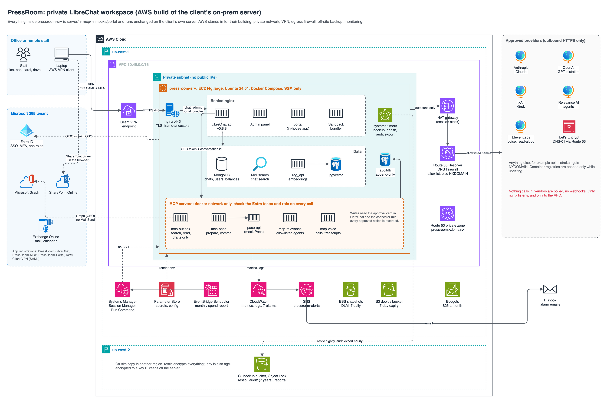

# Architecture

Source: [architecture.drawio](architecture.drawio) (open in draw.io or diagrams.net; the PNG also carries the diagram, so it opens there too). After editing, export with `drawio -x -f png -e --scale 2 --border 20 -o docs/architecture.png docs/architecture.drawio`.

- **Nothing inbound.** Only nginx listens, and only to the VPC (the VPN lands there). Vendors are polled; no webhooks.
- **Identity:** Entra sign-in with app roles (`LibreChat.User`, `LibreChat.Admin`, `Pace.*`, `Outlook.Assistant`). LibreChat gets an on-behalf-of token for the MCP API; each MCP server validates it and checks roles per call.
- **Writes need two approvals:** LibreChat's approval card, then the connector's own rule (Outlook drafts only; Pace prepare then commit; Relevance runs and calls are asked). Every approved action is recorded.
- **What is portable:** `server/`, `mcp/` and `mocks/portal` go onto the client's server unchanged; `infra/` stands in for their building (network, VPN, firewall, backup target, monitoring).
